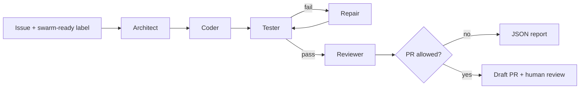

# IssueWeaver Lab
### An issue becomes a plan. A plan becomes code. Tests decide what happens next.

**IssueWeaver** is an educational, test-gated multi-agent maintainer built as an original
engineering lab, not a benchmark claim or an autonomous production deployer. It turns an
*opted-in GitHub issue* from **one explicitly allowed repo** into a draft pull request only
if a restricted Docker test run passes. It never merges or edits the default branch directly.

> Research question: how much autonomy can a coding assistant earn through reproducible
> evidence rather than confidence in its own answer?


## The distinctive idea: evidence-gated autonomy

- **Architect** breaks the issue into max six explicit tasks.
- **Coder** returns complete typed file proposals, never raw commands.
- **Tester** executes pytest in a resource-limited, network-disabled Docker container.
- **Repair** reads the failure output; a fixed attempt budget avoids infinite loops.
- **Reviewer** checks completion and changed-file policy; human review remains mandatory.
- **Publisher** creates an isolated branch and draft PR *only with explicit opt-in*.
- **Evidence trail** records plan / revision / test decisions as a JSON file in `runs/`.

## Visual pipeline



## Start here (no keys, no Docker required)

1. Install Python 3.11+ and dependencies: `python -m pip install -e '.[dev]'`
2. Run `python -m issueweaver demo`
3. Observe **failure -> repair -> success**, then run `python -m pytest -q`.

The demo is a **deliberately deterministic fixture** so students can see the loop with no
API cost. It does not claim that an LLM autonomously solved the sample. See
[`RUN_GUIDE.md`](RUN_GUIDE.md) for exact Windows/macOS/Linux commands and live setup.

## Real mode

Copy `.env.example` to `.env` and fill in credentials (basic KEY=VALUE lines are loaded
automatically), create a **separate private test-target repository**, build
`docker build -t issueweaver-pytest:local sandbox/`, then run:

```bash
python -m issueweaver issue --number 1
# after reviewing a successful dry-run, explicitly enable GITHUB_ALLOW_PR=true:
python -m issueweaver issue --number 1 --publish
```

The live mode requires a GitHub token, OpenAI API key, network access, and Docker daemon.
It operates on the repo named by `GITHUB_REPOSITORY`, **not** automatically on this framework
repository. GitHub issue automation requires a reachable HTTPS webhook endpoint.

## Directory map

```text
.github/workflows/ci.yml       CI lint, tests, and runner image build
src/issueweaver/               Typed Python application, graph, providers and adapters
tests/                         Unit, security, webhook and mocked integration tests
docs/                          Architecture diagram, threat model, learning notes
examples/sample_target/        Deterministic test/repair tutorial input
sandbox/Dockerfile             Restricted test runner image
Dockerfile                     FastAPI application image
pyproject.toml                 Dependencies, package entry point, lint/test settings
RUN_GUIDE.md                   Copy/paste commands and live integration
```

## Scope and verification

This repository includes unit/mocked GitHub integration tests and a trusted sample demo.
**Do not treat it as fully live-validated** without using an actual GitHub test repo,
Docker daemon, webhook endpoint, API key and a review of the proposed PR. Do not expose
Docker's privileged socket to untrusted tenants. For architectural details see
[`docs/architecture.md`](docs/architecture.md) and [`docs/threat-model.md`](docs/threat-model.md).

## Growth roadmap

Build a durable job queue, run-level tracing and cost accounting, AST/file-diff review,
per-language allowlists, ephemeral Firecracker/VM isolation, integration benchmarks against
issue suites, and policy checks before allowing broader autonomy.

## What I learned

Model orchestration is the *easy* half of agentic DevOps. The hard half is defining who
can modify what, what evidence is required before write access, and how to recover from
errors. This project makes those decisions explicit and testable.

**License:** MIT (see `LICENSE`). Contributions welcome after public release.
