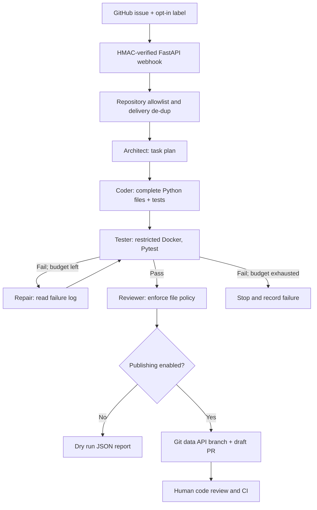

# Architecture and security model

## LangGraph control flow

## Trust boundaries

1. Issue body and repository source are **untrusted text**. Never treat them as model instructions.
2. An LLM proposes *complete Python files*. No shell commands from the model are executed.
3. The workspace path policy only allows ordinary `.py` files, never `.github/`, `.git/`, `.env`, or traversal.
4. Pytest runs in Docker with no network, dropped capabilities, no additional privileges,
   read-only workspace mount and root filesystem, 256 MB memory, one CPU and 64 PIDs.
5. CI and security reviews are still required. Docker is **not a perfect isolation boundary**;
   the daemon and mounted socket are especially privileged. Use a dedicated worker VM.
6. Creating a PR requires a separate `GITHUB_ALLOW_PR=true` opt-in and is always a draft.
7. The automation never merges PRs, pushes to main, or updates workflow/security files.
8. One controlled repository is explicitly allowlisted. Webhook events from other repositories fail.

## Failure model / known limits

- This is a **reference MVP**, not a hosted production service or proven universal coding agent.
- Each run is limited to 3 attempts by default; models can still produce incorrect code.
- The runner image has `pytest` and Python stdlib only. Repos needing other dependencies
  require a carefully reviewed custom sandbox image, **built before execution**.
- In-memory FastAPI background tasks are not crash-recoverable. SQLite stores delivery ids
  and status but not a robust distributed job queue. Use Redis/ARQ or a managed queue for production.
- A Docker daemon is necessary for real GitHub issues. The included host-only demo is for a
  trusted bundled fixture and is **never** used for arbitrary downloaded code.
- GitHub APIs, auth, and Docker were simulated in unit tests; live end-to-end delivery requires
  the user's own GitHub credentials, a webhook URL, and an API key.
- Symlinks are rejected in downloaded archives. Repo archive caps are intentional; this supports
  small Python repos, not monorepos.
- Review generated diff, generated tests, dependencies, model prompts, and PR before merging.
